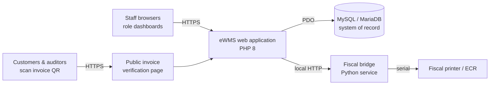

# eWMS — Architecture

**eWMS** is a wholesale management system for pharmaceutical and medical-supply distributors.
It runs the whole cycle from buying stock to collecting payment: purchasing, batch-level
inventory, sales orders, invoicing, payments, and a full finance module (general ledger,
banks, budgets, payroll), all with role-based access.

This repository documents **how eWMS is designed**. It contains architecture documentation
only; the application source code is private.

## At a glance

| | |
|---|---|
| **Domain** | Wholesale distribution of medicines and medical equipment |
| **Users** | Seven operational roles, from storekeeper to general manager |
| **Stack** | PHP 8, MySQL/MariaDB, Bootstrap 5, jQuery, Chart.js |
| **Architecture** | Server-rendered multi-page app with a shared core library |
| **Deployment** | Single organization per installation, on Apache |
| **Integrations** | Fiscal cash register (ECR) bridge, verifiable invoice QR codes |
| **Calendars** | Gregorian and Ethiopian dates; ETB currency by default |

## Documentation

| Document | What it covers |
|---|---|
| [Architecture overview](docs/architecture.md) | Layers, request lifecycle, design decisions |
| [Modules](docs/modules.md) | Each functional module and the roles that use it |
| [Data flows](docs/data-flows.md) | Purchase-to-stock, order-to-cash, and finance posting |
| [Data model](docs/data-model.md) | Main entities and how they relate |
| [Security model](docs/security-model.md) | Authentication, authorization, and data protection |
| [Invoice verification](docs/invoice-verification.md) | How invoice QR codes prove an invoice is genuine |
| [Deployment](docs/deployment.md) | Runtime topology and operations |

## Design principles

- **The database is the single source of truth.** Every page reads live data, and every
  stock or money movement is a database transaction.
- **Batch-level traceability.** Stock is tracked per batch with expiry dates, so every unit
  sold can be traced back to the purchase it came from.
- **Least privilege.** Each role sees only the modules it needs, and sensitive actions are
  limited to specific roles.
- **Paper you can trust.** Printed invoices carry a signed QR code that anyone can scan to
  confirm the invoice is genuine and see its current status.
- **Simple to host.** No framework or build step; it runs on a standard PHP and MySQL host.

---

© Horoo Innovations. Documentation published for information; all rights reserved.
