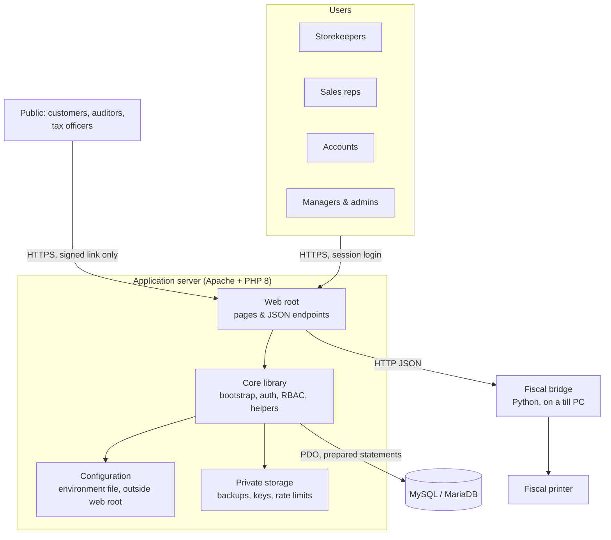
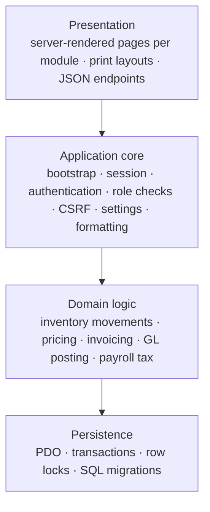
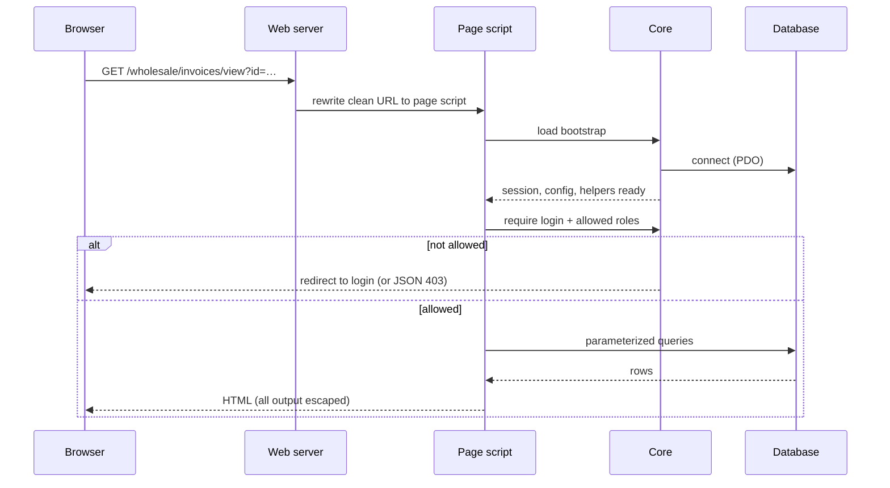

# Architecture overview

## System context

Only the **web root** is exposed by the web server. Configuration, the core library,
migrations and private storage sit outside it and can't be requested over HTTP.

## Layers

| Layer | Responsibility |
|---|---|
| **Presentation** | One page script per screen, rendered on the server with Bootstrap. Shared header, sidebar and footer templates. JavaScript enhances pages (searchable pickers, charts) but isn't required to read data. |
| **Application core** | A single bootstrap file every page loads first. It reads configuration, opens the database, starts a hardened session, and loads the helper and access-control libraries. |
| **Domain logic** | Shared helpers for the rules that must be identical everywhere: price resolution, stock movement, tax, Ethiopian calendar conversion, ledger posting. |
| **Persistence** | MySQL accessed only through PDO with bound parameters. Multi-step changes run in transactions, and concurrent updates use row locks (`SELECT … FOR UPDATE`). |

## Request lifecycle

State-changing requests are always `POST`, carry a per-form CSRF token, and follow
**Post/Redirect/Get**, so refreshing a page never repeats an action.

## Key design decisions

| Decision | Reason |
|---|---|
| **No framework, plain PHP 8** | Runs on low-cost shared hosting common in the target market, with no build step or dependency manager to operate. |
| **Server-rendered multi-page app** | Works on modest hardware and slow connections, and every screen prints well. |
| **Clean URLs, no `.php` extension** | Stable, readable links; the web server maps them to page scripts. |
| **SQL migrations in version control** | Schema changes are reviewed and applied in order on every installation. |
| **Batch-level inventory** | Pharmaceutical stock needs expiry tracking and recall traceability. |
| **Signed, verifiable invoices** | Customers and auditors can check a printed invoice without an account (see [invoice verification](invoice-verification.md)). |
| **Fiscal printing through a local bridge** | Fiscal printers connect by serial port to a till PC, and a small local service connects the web app to the device. |

## Cross-cutting concerns

| Concern | Approach |
|---|---|
| Configuration | Environment file outside the web root, plus a `settings` table for business options editable in the UI |
| Dates | Stored in Gregorian; Ethiopian calendar shown and accepted where finance needs it |
| Money | Fixed two-decimal amounts; currency symbol from settings (ETB by default) |
| Printing | Dedicated print layouts for invoices, purchase orders, bin cards and reports |
| Exports | CSV and Excel exports for reports |
| Logging | Application errors to server logs; business actions to an audit log table |
| Maintenance | A maintenance mode that only Super Admins can bypass |
