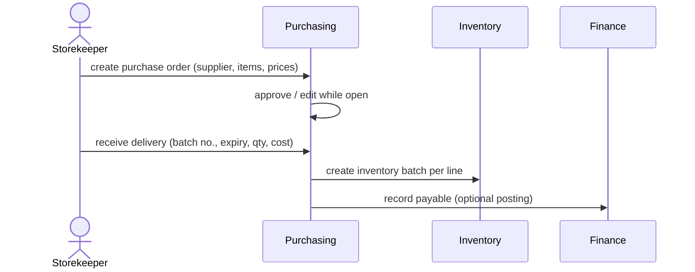
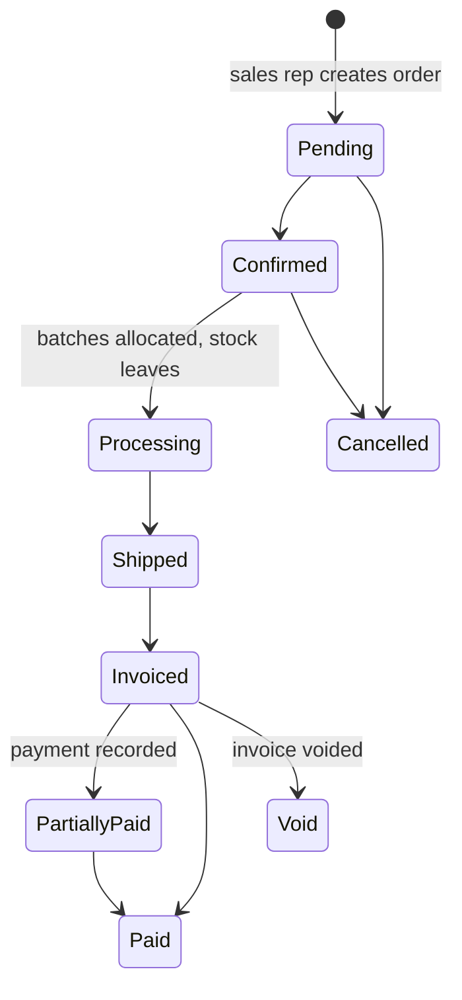
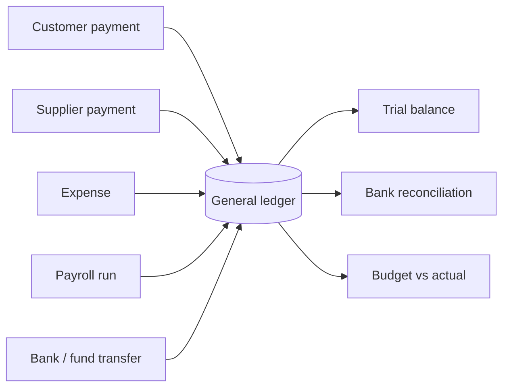

# Data flows

## Purchase to stock

Receiving can be partial; the order stays open until fully received.

## Order to cash

| Step | Effect |
|---|---|
| **Order** | Price resolved per customer: customer-specific price, then the customer's price list, then the default list. |
| **Fulfil** | Stock is allocated from specific batches, earliest expiry first by default, and quantity on hand is reduced in the same transaction. |
| **Invoice** | Creates the receivable and tax figures. Stock isn't touched again, since it already left at fulfilment. |
| **Fiscal print** | The invoice is sent to the fiscal printer through the bridge; the fiscal receipt number is stored on the invoice. |
| **Payment** | Locks the invoice row, adds the payment, updates paid amount and status, and posts to the ledger. |
| **Void** | Invoice becomes void and drops out of revenue. Stock movement history is kept for traceability. |

## Concurrency and integrity

Two people may act on the same record at once, for example two cashiers taking payments
on one invoice, or two storekeepers adjusting one batch. Every such update:

1. starts a database transaction,
2. re-reads the row with `SELECT … FOR UPDATE`, which makes the second request wait,
3. re-checks business rules against the locked values (balance due, stock available),
4. writes and commits, or rolls back everything on any error.

This prevents lost updates, overpayment and negative stock.

## Finance posting

The general ledger is double-entry against the chart of accounts. Each bank is linked to a
ledger account, and bank reconciliation matches statement lines against ledger entries.
