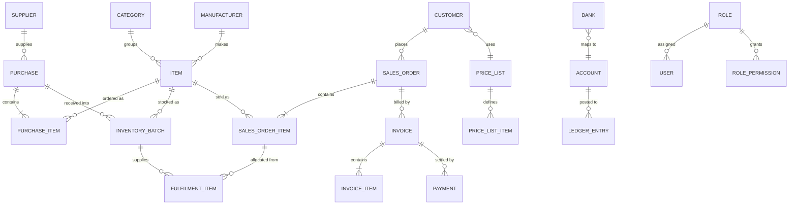

# Data model

The main entities are shown below; supporting tables (settings, audit log, rate limits,
migrations) are left out.

## Notes

| Area | Detail |
|---|---|
| **Identity** | Users have one role. Roles map to permission slugs, so features can be turned on per role without code changes. |
| **Stock** | Quantity lives on each **inventory batch** (batch number, expiry, cost, location), not on the item. An item's stock is the sum of its batches. |
| **Traceability** | Fulfilment rows link each sold quantity to the exact batch it came from, with a timestamp. Stock cards and recalls are built from these. |
| **Documents** | Order and invoice numbers are unique in the database. |
| **Money** | Amounts are stored as fixed-precision decimals; totals are stored on documents and checked against their lines. |
| **History** | Items, suppliers and customers are deactivated rather than deleted when they have history, so old reports stay complete. |
| **Schema changes** | Applied through ordered SQL migration files kept in version control. |
