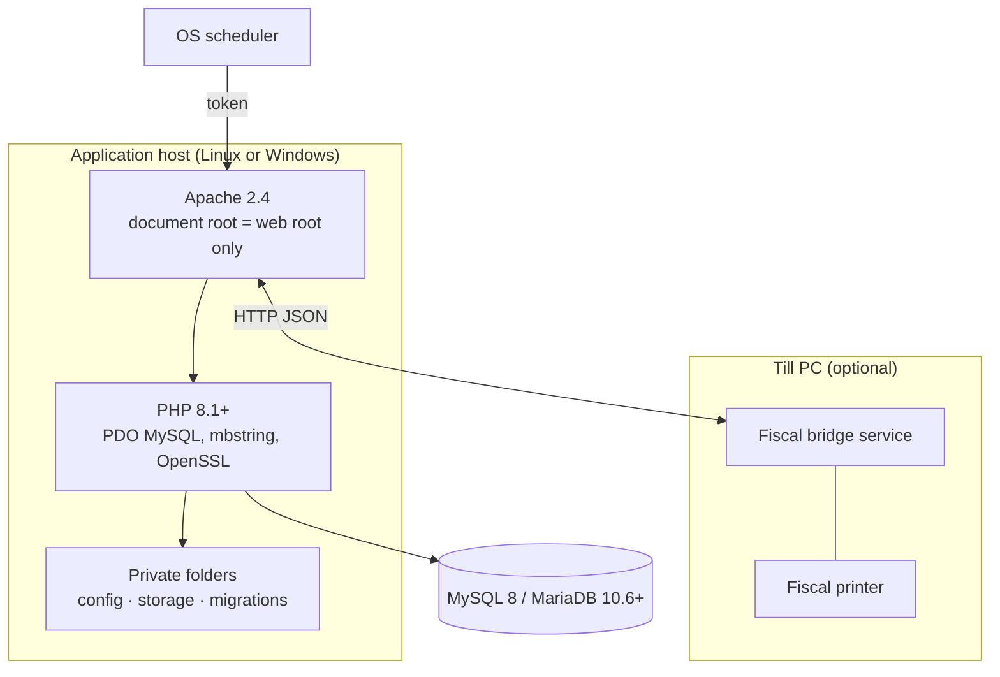

# Deployment

## Topology

## Requirements

| Component | Requirement |
|---|---|
| Web server | Apache 2.4 with `mod_rewrite` and `mod_headers` (`.htaccess` enabled) |
| PHP | 8.1 or newer with PDO MySQL, mbstring, OpenSSL and JSON. No image extension is needed. |
| Database | MySQL 8 or MariaDB 10.6+, `utf8mb4` |
| TLS | HTTPS certificate for production |
| Fiscal printing | Optional Windows PC with the printer on a serial port, running the Python bridge |

## Configuration

- An **environment file** outside the web root holds database credentials, the base URL,
  environment mode and signing keys. It is never committed to version control.
- **Business settings** (company name, logo, tax ID, currency, invoice wording, enabled
  modules) live in the database and are edited in the UI.

## Operations

| Task | How |
|---|---|
| Install / upgrade schema | Run the ordered SQL migrations |
| Backups | Scheduled compressed dumps to a private folder, plus on-demand backups from the UI |
| Restore | Super Admin only, from Backup Management |
| Upgrades | Maintenance mode on, deploy, migrate, maintenance mode off |
| Monitoring | Server error logs and the in-app audit log |

## Hardening checklist

- Point the document root at the web root folder only.
- Serve over HTTPS and enable secure session cookies.
- Keep debug mode off in production.
- Set a long random signing key in the environment file, and keep it stable.
- Hide server version banners in the main web server configuration.
- Restrict database user privileges to the application database.
