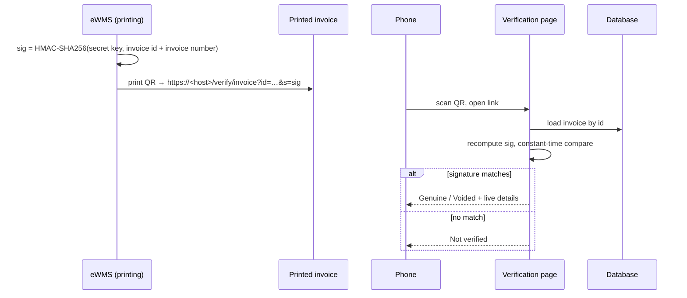

# Invoice verification

Every printed eWMS invoice carries a QR code. Anyone can scan it with a phone camera, with
no account or app, to confirm the invoice was really issued by the organization and to see
its **current** status.

## What the scanner sees

| Result | Meaning |
|---|---|
| ✔ **Genuine invoice** | Issued by the organization and matches its records. Shows the invoice number, date, customer, total, amount paid, balance and status, so the reader can compare them with the paper. |
| ✖ **Invoice voided** | Genuine, but voided after printing. It's no longer valid for payment or tax. |
| ✖ **Not verified** | The code was altered or wasn't produced by the system. |

## How it works

- **Tamper-proof link.** The signature is an HMAC using a secret key that never leaves the
  server. Changing the invoice number in the link, or forging a link for another invoice,
  makes the signature fail.
- **Live status.** The page reads the database at scan time, so a voided invoice shows as
  voided even if the paper copy looks fine.
- **Limited disclosure.** The page shows only what's already printed on the invoice, plus
  its payment status. It's marked `noindex` and isn't cached.
- **Unguessable.** Invoice ids are sequential, but each link needs its own 96-bit signature,
  so other invoices can't be found by changing the number.

## The QR code itself

The code is drawn as SVG directly from the QR matrix, so it needs no image extension on the
server and prints sharply at any size. It uses rounded modules, high error correction (so a
centre "verified" badge doesn't affect scanning), and the organization's name printed in the
frame. The design was checked with standard decoders at the printed size.
