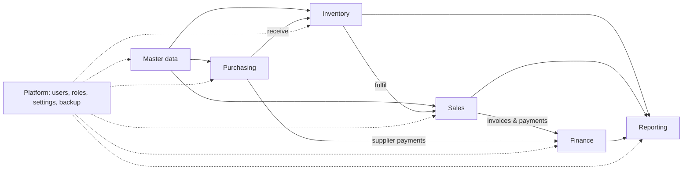

# Modules

## Functional modules

| Module | What it does |
|---|---|
| **Master data** | Items, categories, manufacturers, suppliers, customers, customer groups, and price lists (fixed price or a percentage markup on cost, with per-item and per-batch overrides). |
| **Inventory** | Stock per batch with expiry date, quantity on hand and location. Covers stock adjustments with reasons, internal requisitions, customer returns, and expiry and low-stock monitoring. |
| **Purchasing** | Purchase orders from draft to approval to receiving. Receiving creates inventory batches; also records withholding tax and supplier references. |
| **Sales** | Sales orders, batch allocation and fulfilment, shipping, invoicing (with fiscal receipt printing), customer payments against invoices, and invoice voiding. |
| **Finance** | Chart of accounts, general ledger and journal entries, banks, bank reconciliation, bank and fund transfers, expenses, supplier payments, budgets with approval and budget-vs-actual, and payroll with income-tax calculation. |
| **Reporting** | Stock level, valuation, bin card / stock card, expiry, receiving and adjustment reports; sales, payment, customer statement and profit reports; trial balance, receivables, payables, revenue and audit-tax reports. Most export to CSV or Excel. |
| **Platform** | Users, roles and permissions, business settings and branding, backup management, maintenance mode, and the audit log. |

## Roles

Each role lands on its own dashboard and sees only the menus it needs.

| Role | Typical responsibilities |
|---|---|
| **Super Admin** | System owner: all access, Super Admin accounts, restores, maintenance mode |
| **Admin** | Day-to-day administration: users, master data, settings, all operations |
| **General Manager** | Oversight across all modules, approvals, management reporting |
| **Technical Manager** | Product and stock oversight, approvals, operational reporting |
| **Accounts** | Payments, finance module, financial reports |
| **Sales Rep** | Customers, sales orders, invoices |
| **Storekeeper** | Purchasing, receiving, stock movements, store reports |

Access is enforced on the server for every page and every JSON endpoint, not only by hiding
menu items. Details are in the [security model](security-model.md).
