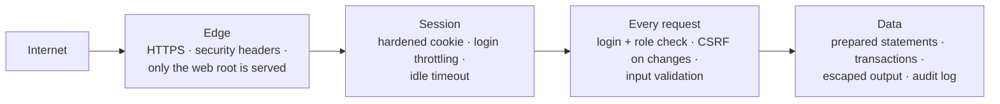

# Security model

eWMS holds commercial and financial data, so security is designed in layers: the network
edge, the session, every request, and the data itself.

## Authentication

- Passwords are stored with PHP's `password_hash` (bcrypt) and checked with `password_verify`.
- The session ID is regenerated at login to prevent session fixation.
- Session cookies are `HttpOnly`, `SameSite=Lax`, and `Secure` when served over HTTPS.
- Sessions expire after a period of inactivity.
- Failed logins are throttled at three levels: per username and address, per account from
  any address, and per address across all usernames. This limits both targeted guessing
  and password spraying.
- Login errors use one generic message, so it can't be used to discover which usernames exist.

## Authorization

- Every page and every JSON endpoint declares which roles may use it, and the server checks
  this on each request. Hiding a menu item is never the only control.
- Fine-grained permissions extend roles for selected features.
- Super Admin accounts can only be created, changed or reset by a Super Admin, and the last
  active Super Admin can't be removed.

## Request and data protection

| Threat | Control |
|---|---|
| SQL injection | All queries use PDO with bound parameters |
| Cross-site scripting | All dynamic output is HTML-escaped; Content-Security-Policy limits script and frame sources |
| Cross-site request forgery | Per-form tokens on every state-changing request; changes are `POST`-only |
| Clickjacking | `X-Frame-Options` and `frame-ancestors` |
| File upload abuse | File-type allow-list, image validation, and sanitizing of uploaded SVG logos |
| Sensitive file exposure | Only the web root is served; configuration, backups, keys and logs live outside it |
| Data races | Transactions with row locks on money and stock updates |

## Operations

- **Backups** are compressed database dumps kept outside the web root. Only management roles
  can download them, and only a Super Admin can restore.
- **Scheduled backups** are triggered by the server's scheduler with a secret token.
- **The audit log** records logins, failed logins, and key business actions with user and address.
- **Maintenance mode** blocks everyone except Super Admins during upgrades.

## Reporting a vulnerability

If you think you've found a security issue in eWMS, contact Horoo Innovations privately rather
than opening a public issue.
